# Use Case Diagrams — Tana Parking

**Document ID:** UCD-TANA-PARK-001  
**Version:** 1.0  
**Date:** 13 July 2026  
**Related:** [SRS](./SRS-Tana-Parking-v1.0.md) | [Test Plan](./Test-Plan-Tana-Parking-v1.0.md)

---

## 1. Overview

This document provides UML use-case diagrams per functional module. Actors:

| Actor | Description |
|-------|-------------|
| **System Admin** | Full platform configuration |
| **Director** | Operations leadership |
| **Supervisor** | Zone-scoped valet management |
| **Finance Officer** | Revenue and payment oversight |
| **Valet** | Field parking operations |
| **Customer** | Passive — receives SMS, pays via Chapa |
| **Chapa** | External payment gateway |
| **Twilio** | External SMS provider |

---

## 2. System context (high level)

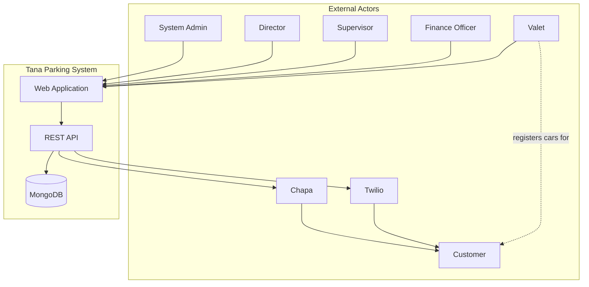

---

## 3. Module: Authentication (AUTH)

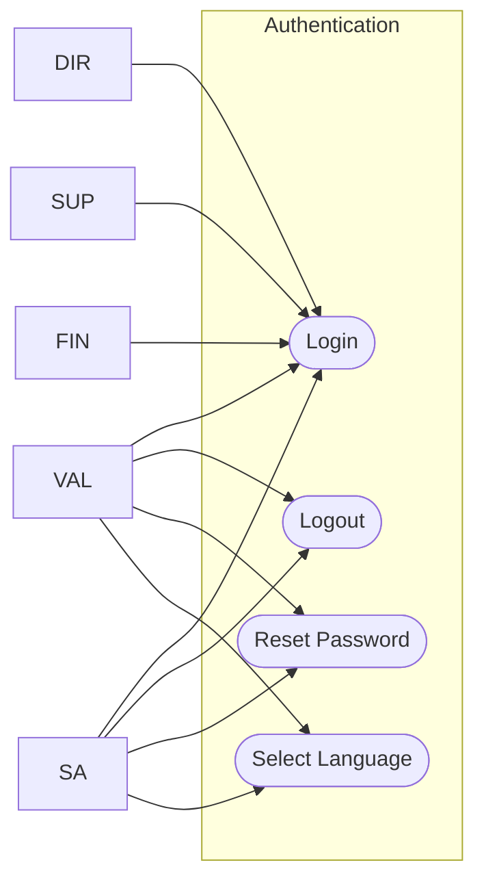

| Use case | Actor(s) | Description |
|----------|----------|-------------|
| UC-AUTH-01 Login | All staff | Authenticate with phone + password; receive JWT |
| UC-AUTH-02 Logout | All staff | End session, clear credentials |
| UC-AUTH-03 Reset password | All staff | Change password with validation rules |
| UC-AUTH-04 Select language | All staff | Set EN/AM preference in profile |

---

## 4. Module: Staff management (STAFF)

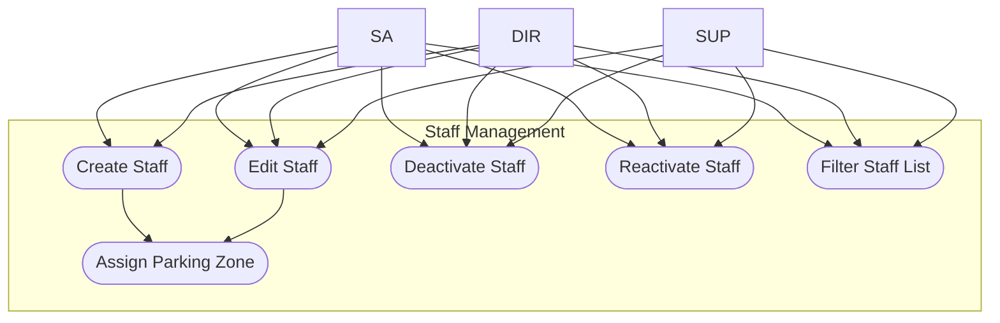

| Use case | Actor(s) | Preconditions | Postconditions |
|----------|----------|---------------|----------------|
| UC-STAFF-01 Create staff | System Admin, Director | Actor can create target role | User record created; welcome SMS sent |
| UC-STAFF-02 Edit staff | System Admin, Director, Supervisor* | Actor can manage target user | User updated; valet price level synced from zone |
| UC-STAFF-03 Deactivate staff | System Admin, Director, Supervisor* | Target not self | `isActive = false`; user cannot login |
| UC-STAFF-04 Reactivate staff | System Admin, Director, Supervisor* | User inactive | `isActive = true` |
| UC-STAFF-05 Assign zone | System Admin, Director | Zone has price level (valet) | `parkZoneCode` set; price level inherited |
| UC-STAFF-06 Filter staff | All staff managers | Staff list loaded | Filtered view by role/zone/status |

\* Supervisor: valets in assigned zone(s) only.

---

## 5. Module: Parking zones (ZONE)

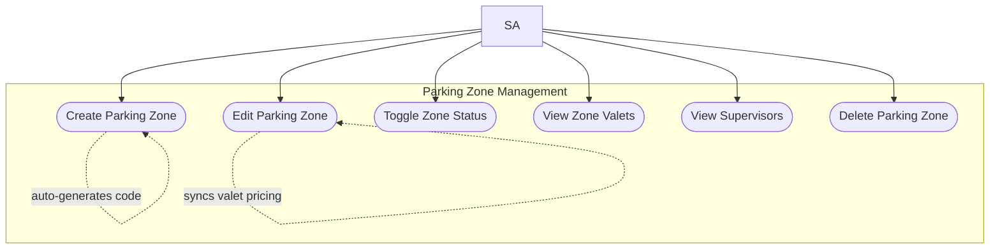

| Use case | Actor | Main flow |
|----------|-------|-----------|
| UC-ZONE-01 Create zone | System Admin | Enter name, location, price level → code auto-generated |
| UC-ZONE-02 Edit zone | System Admin | Update fields → valets in zone synced if price level changed |
| UC-ZONE-03 Toggle status | System Admin | Active ↔ Inactive on zone list |
| UC-ZONE-04 View valets | System Admin | Modal lists valets assigned to zone |
| UC-ZONE-05 View supervisors | System Admin | Table shows supervisors covering zone |
| UC-ZONE-06 Delete zone | System Admin | Blocked if staff assigned; else removed |

---

## 6. Module: Pricing and VAT (PRICE)

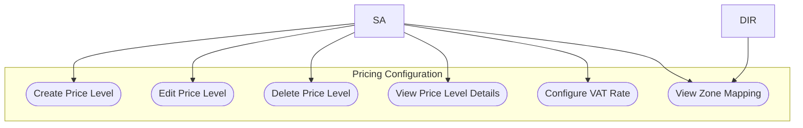

| Use case | Actor | Business rules |
|----------|-------|----------------|
| UC-PRICE-01 Create level | System Admin | Unique name; rates for 5 car types × 4 durations |
| UC-PRICE-02 Edit level | System Admin | Update hourly/package rates per car type |
| UC-PRICE-03 Delete level | System Admin | Blocked if assigned to any parking zone |
| UC-PRICE-04 View details | System Admin | Read-only pricing table modal |
| UC-PRICE-05 Configure VAT | System Admin | Enable/disable; set percentage; history tracked |
| UC-PRICE-06 Zone mapping | System Admin, Director | Read-only table: zone name → price level |

---

## 7. Module: Vehicle operations (PARK)

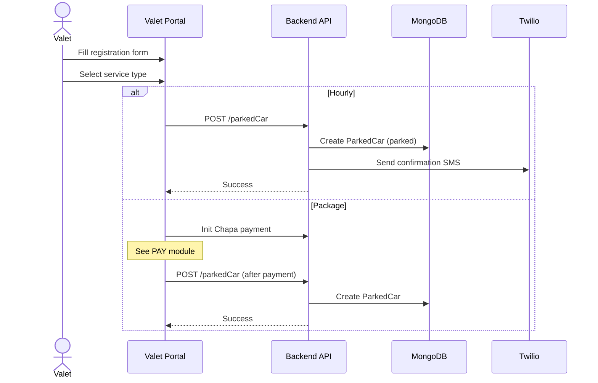

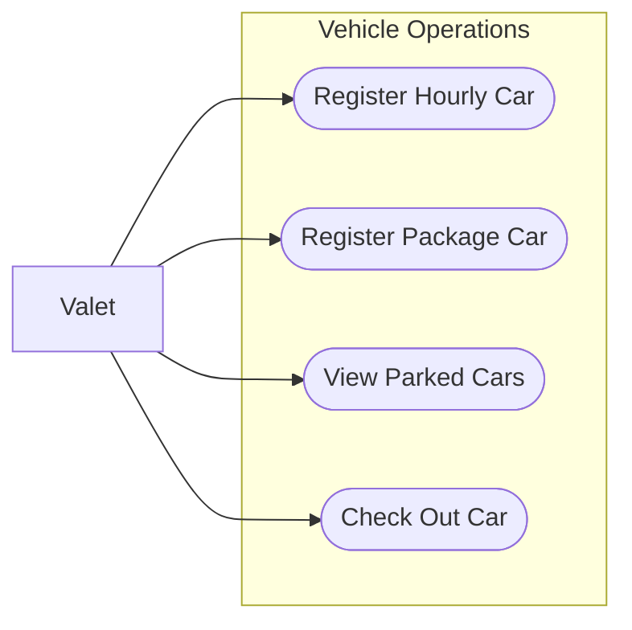

| Use case | Actor | Extensions |
|----------|-------|------------|
| UC-PARK-01 Register hourly | Valet | E1: Duplicate plate → error; E2: Flagged customer → blocked |
| UC-PARK-02 Register package | Valet | Includes Chapa payment (UC-PAY-01) |
| UC-PARK-03 View parked cars | Valet | Scoped to valet zone |
| UC-PARK-04 Check out car | Valet | May trigger flagging if unpaid (UC-FLAG-01) |

---

## 8. Module: Payments (PAY)

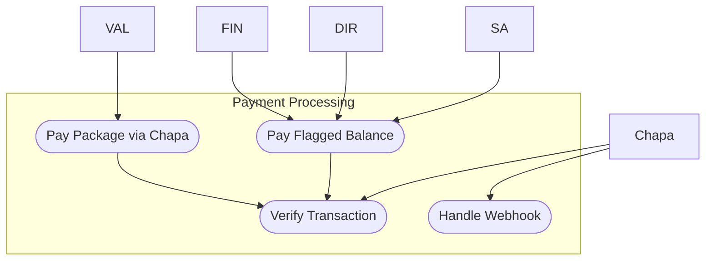

| Use case | Actor | Flow |
|----------|-------|------|
| UC-PAY-01 Package payment | Valet | Init payment → Chapa modal → verify txRef → create car |
| UC-PAY-02 Verify transaction | System, Chapa | GET verify endpoint; confirm successful status |
| UC-PAY-03 Flagged payment | Finance, Director, Admin | Calculate fee → Chapa → update car payment |
| UC-PAY-04 Webhook | Chapa | POST callback/webhook; reconcile payment state |

---

## 9. Module: Flagged customers (FLAG)

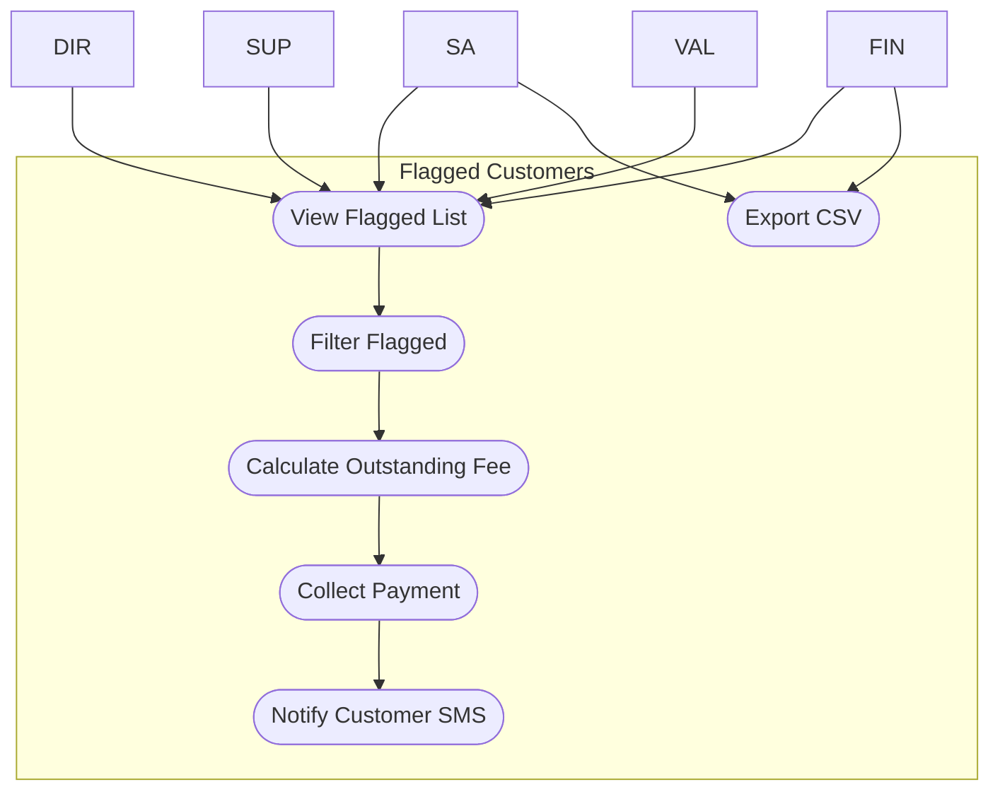

| Use case | Actor | Zone scope |
|----------|-------|------------|
| UC-FLAG-01 View flagged | Office staff, Valet | Supervisor/valet: own zone(s) |
| UC-FLAG-02 Filter | All viewers | By zone, status, search |
| UC-FLAG-03 Calculate fee | System | Pricing + VAT from settings |
| UC-FLAG-04 Collect payment | Finance, Director, Admin | Chapa modal |
| UC-FLAG-05 Notify SMS | Authorized staff | Twilio integration |
| UC-FLAG-06 Export CSV | System Admin, Finance | Download flagged list |

---

## 10. Module: Reporting (RPT)

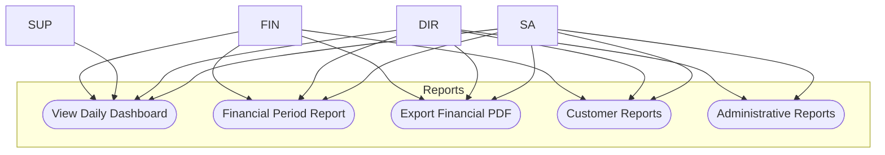

| Use case | Actor | Access |
|----------|-------|--------|
| UC-RPT-01 Dashboard | All office staff | Revenue + cars by zone/valet/date |
| UC-RPT-02 Financial report | Admin, Director, Finance | Period revenue breakdown |
| UC-RPT-03 PDF export | Admin, Director, Finance | Download period report |
| UC-RPT-04 Customer reports | Admin, Director, Finance | History, activity |
| UC-RPT-05 Admin reports | Admin, Director | Staff performance, compliance |

---

## 11. Module: Communication (COMM)

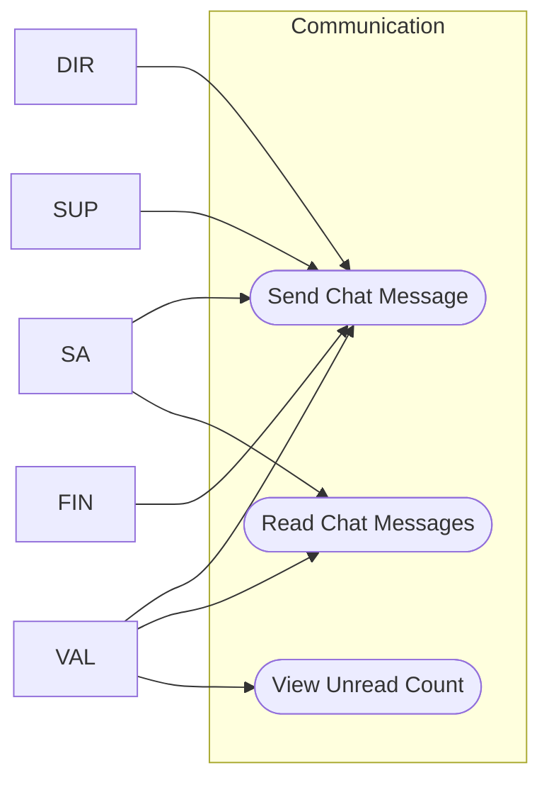

| Use case | Actor | Technology |
|----------|-------|------------|
| UC-COMM-01 Send message | All staff + valets | Socket.IO + REST |
| UC-COMM-02 Read messages | All staff + valets | Polling / socket |
| UC-COMM-03 Unread badge | All chat users | Real-time counter |

---

## 12. Module: Localization (I18N)

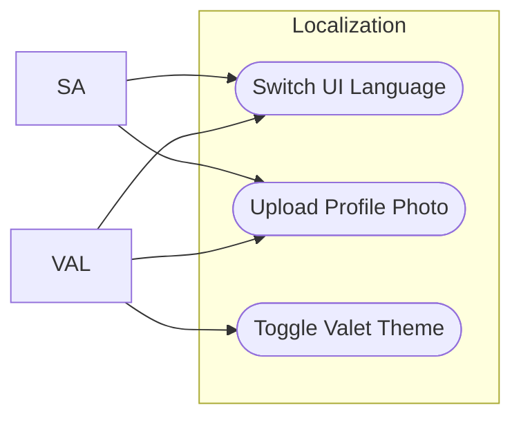

---

## 13. Use case → SRS traceability

| Use case ID | SRS requirements |
|-------------|------------------|
| UC-AUTH-* | REQ-AUTH-001 – 007 |
| UC-STAFF-* | REQ-STAFF-001 – 013 |
| UC-ZONE-* | REQ-ZONE-001 – 007 |
| UC-PRICE-* | REQ-PRICE-001 – 008 |
| UC-PARK-* | REQ-PARK-001 – 010 |
| UC-PAY-* | REQ-PAY-001 – 006 |
| UC-FLAG-* | REQ-FLAG-001 – 007 |
| UC-RPT-* | REQ-RPT-001 – 009 |
| UC-COMM-* | REQ-COMM-001 – 004 |
| UC-I18N-* | REQ-I18N-001 – 004 |

---

## 14. Actor participation summary

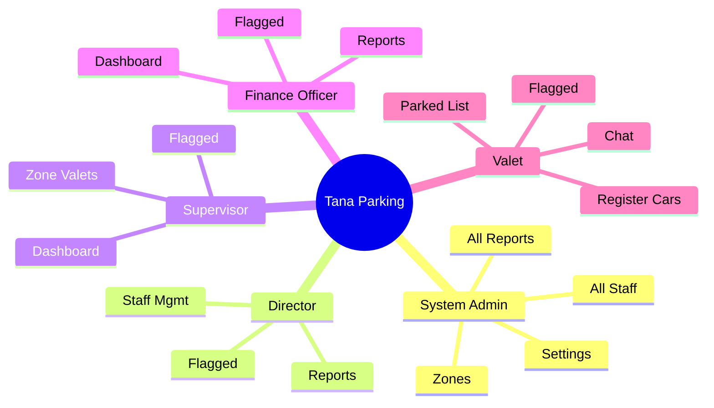
